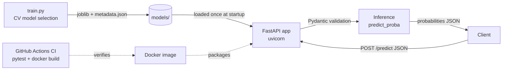

# Real-Time ML Inference REST API

A production-style microservice that serves a trained **champion model** (Breast Cancer Wisconsin
classifier, scikit-learn) through a **FastAPI** REST API, packaged as a **Docker** image with pinned
dependencies and covered by an automated test suite.

> Swap in your own capstone model: replace the data/candidates in `train.py`, re-run it, and the API
> adapts automatically (feature count, class labels and version come from `models/metadata.json`).

## 1. System architecture



| Stage | File | Responsibility |
|---|---|---|
| Training / selection | `train.py` | Compares Logistic Regression, Random Forest and Gradient Boosting via 5-fold CV ROC-AUC, refits the winner, exports `model.joblib` + `metadata.json` |
| Serving | `app/main.py` | Loads artifacts once at startup (lifespan), exposes endpoints, validates input, returns probabilities |
| Contracts | `app/schemas.py` | Pydantic request/response models (also drive the auto-generated OpenAPI docs) |
| Tests | `tests/test_api.py` | Schema, status-code, determinism and edge-case tests |
| Packaging | `Dockerfile`, `requirements.txt` | Reproducible image, pinned deps, non-root user, health check |
| CI | `.github/workflows/ci.yml` | Runs tests and builds the image on every push |

**Champion model:** Logistic Regression + StandardScaler — CV ROC-AUC 0.9935; held-out test
ROC-AUC 0.9954, accuracy 0.9825, F1 0.9861 (see `GET /model-info`).

## 2. Project layout

```
.
├── app/
│   ├── main.py          # FastAPI app and endpoints
│   └── schemas.py       # Pydantic models
├── models/
│   ├── model.joblib     # trained champion
│   └── metadata.json    # version, feature names, classes, metrics
├── tests/test_api.py
├── train.py
├── Dockerfile
├── requirements.txt / requirements-dev.txt
└── .github/workflows/ci.yml
```

## 3. Quick start

### Run locally
```bash
python -m venv .venv && source .venv/bin/activate
pip install -r requirements-dev.txt
python train.py                         # optional: regenerates models/
uvicorn app.main:app --reload           # http://localhost:8000/docs
```

### Run with Docker
```bash
docker build -t ml-inference-api .
docker run --rm -p 8000:8000 ml-inference-api
```

### Run the tests
```bash
pytest -v
```

## 4. API reference

Base URL: `http://localhost:8000`

### `GET /health`
Liveness/readiness probe.
```json
{"status": "ok", "model_loaded": true}
```

### `GET /model-info`
Returns model metadata: name, version, ordered `feature_names`, `n_features`, class mapping, test metrics.

### `POST /predict`
Predict for one instance. `features` must be a list of **30 finite floats** in the order returned by `/model-info`.

Request
```json
{"features": [17.99, 10.38, 122.8, 1001.0, 0.1184, 0.2776, 0.3001, 0.1471, 0.2419, 0.07871,
              1.095, 0.9053, 8.589, 153.4, 0.006399, 0.04904, 0.05373, 0.01587, 0.03003, 0.006193,
              25.38, 17.33, 184.6, 2019.0, 0.1622, 0.6656, 0.7119, 0.2654, 0.4601, 0.1189]}
```

Response `200`
```json
{
  "prediction": 0,
  "label": "malignant",
  "probabilities": {"malignant": 1.0, "benign": 0.0},
  "model_version": "1.0.0"
}
```

```bash
curl -X POST localhost:8000/predict -H "Content-Type: application/json" \
     -d '{"features": [17.99,10.38,122.8,1001,0.1184,0.2776,0.3001,0.1471,0.2419,0.07871,1.095,0.9053,8.589,153.4,0.006399,0.04904,0.05373,0.01587,0.03003,0.006193,25.38,17.33,184.6,2019,0.1622,0.6656,0.7119,0.2654,0.4601,0.1189]}'
```

### `POST /predict/batch`
Up to 1000 instances: `{"instances": [[...30 floats...], [...]]}` → `{"predictions": [ {…same as /predict…}, … ]}`.

### Status codes

| Code | Meaning |
|---|---|
| 200 | Prediction returned |
| 404 | Unknown route |
| 405 | Wrong HTTP method (e.g. `GET /predict`) |
| 422 | Invalid payload: missing/mistyped field, wrong feature count, non-finite values, ragged batch, empty list |

### Authentication (optional)
Set the `API_KEY` environment variable and `/predict` and `/predict/batch` require an `X-API-Key` header (401 otherwise); `/health` stays open.
```bash
docker run -p 8000:8000 -e API_KEY=secret123 ml-inference-api
curl -X POST localhost:8000/predict -H "X-API-Key: secret123" -H "Content-Type: application/json" -d @sample_request.json
```
Every response carries an `X-Process-Time-Ms` header, and each request is logged with method, path, status and latency.

### Also included
`docker-compose.yml` (`docker compose up`), a `Makefile` (`make test`, `make run`), `sample_request.json`, and [`MODEL_CARD.md`](MODEL_CARD.md) (intended use, data, metrics, limitations).

## 5. Design decisions

- **Model loaded once** at startup via FastAPI lifespan, so there is no per-request disk I/O.
- **Metadata-driven validation:** feature count and labels come from `metadata.json`, so retraining never requires API code changes.
- **Pinned dependencies** and `scikit-learn` version recorded in metadata; this avoids unpickling mismatches between train and serve.
- **Container hardening:** slim base image, non-root user, `HEALTHCHECK`, no dev/test files in the image.
- **Sync endpoints:** inference is CPU-bound, so FastAPI runs it in a threadpool without blocking the event loop.

## 6. Possible extensions

Authentication/API keys, request logging + Prometheus metrics, model registry (MLflow) and
canary deploys, drift monitoring, horizontal scaling behind a load balancer (e.g. `uvicorn --workers N` or Kubernetes HPA).
